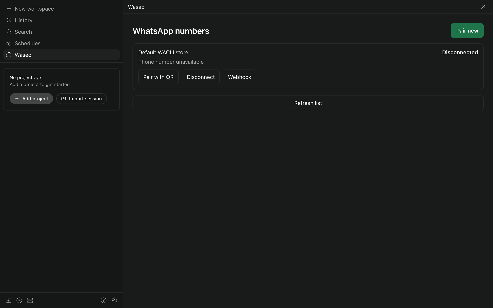

  

<h1 align="center">Waseo</h1>

WhatsApp for Paseo agents, powered by WACLI.

  

Waseo connects WhatsApp accounts to Paseo. Pair with a QR code, manage multiple numbers, read synced conversations, and let the agents you choose help with messages.

## What is Waseo?

Waseo is a Paseo plugin for managing WhatsApp linked devices through [WACLI](https://github.com/openclaw/wacli). It shows paired accounts and their connection status, manages message sync, provides access to the local message archive, and can forward live events to a webhook you configure.

## What you can do

- Pair and manage multiple WhatsApp numbers from Paseo.
- Read messages from one or several chats over a date range. Reading does not require confirmation.
- Find synced contacts and check account connection status.
- Send text messages after confirming the exact account and recipient, then confirming the full message.
- Forward live message, receipt, and chat presence events to your webhook.
- Start, stop, or restart WACLI sync, manage startup behavior, uninstall WACLI, or wipe its data from settings.

## Use Waseo with agent sessions and Bots

Waseo works with interactive Paseo sessions and the [Bots plugin](https://paseo.sh/plugins/oliexe/bots). Access is off by default. In a regular workspace, select agents from the Waseo logo button in the workspace header. In a Bots chat, use its **Active** or **Inactive** composer control. Bot access applies to that Bot's chats. The agent must be idle with no pending permissions while access changes. Waseo reloads the agent to add or remove its tools.

Once enabled, an agent can list paired accounts, find contacts, read one or many chats, and prepare a message. Reading is available without confirmation. Sending requires two separate confirmations: first the WhatsApp account and exact contact, then the exact message text.

## Get started

1. Install Waseo in Paseo and open **Waseo** from the sidebar.
2. If WACLI is not installed, choose **Install WACLI**. Waseo detects an existing WACLI installation automatically.
3. Choose **Pair new** and scan the QR code from WhatsApp under **Linked Devices**.
4. Enable Waseo for a session or Bot when you want it to use WhatsApp. Waseo access controls are off by default.

That is it. Waseo manages sync for the paired number and agents can use its tools when enabled. If an account needs to be linked again, pair it from the Waseo page.

## Why WACLI?

WACLI is a lightweight Go command-line client that syncs WhatsApp data into local SQLite databases. Waseo manages its sync process and uses its JSON interface, so it does not need a separate hosted messaging service. Each named WACLI account keeps its own session and local store. Synced history can be searched locally even while the live connection is unavailable, though WhatsApp history coverage is best-effort.

## Security and privacy

- WACLI stores linked-device credentials and the message archive on the machine running the Paseo daemon.
- Message content given to an agent is also sent to that agent's configured model provider.
- Webhooks send live event data to the URL you configure. Waseo adds a `waseo_account` parameter so one endpoint can identify the WhatsApp account. Use HTTPS except for localhost. Delivery is best-effort and is not retried by Waseo.
- A signing secret is optional. When set, WACLI signs requests with `X-Wacli-Signature`. Waseo keeps the secret in memory and passes it to WACLI as a process argument while sync runs. Enter it again after a plugin or daemon restart.
- Uninstalling WACLI keeps its data. **Wipe WACLI data** removes paired sessions, account settings, local archives, and media. The numbers must be paired again afterward.
- WACLI uses the WhatsApp Web protocol. It is not an official WhatsApp or Meta API, and protocol changes may affect compatibility.
- Before sending, Waseo requires confirmation of both the exact recipient and the exact message. Reads do not require confirmation.

## Technical information

- Requires Paseo 0.16.2 or later.
- WACLI must be available on the Paseo daemon machine. Waseo's built-in installer supports Linux x64 and ARM64. On other systems, install WACLI using its [official instructions](https://github.com/openclaw/wacli) and ensure it is on the daemon's `PATH`.
- Multiple numbers require a WACLI version with named account support.
- Set `WACLI_BINARY` in the daemon environment if WACLI is installed outside the daemon's `PATH`.
- The webhook endpoint must use HTTPS, except for localhost. A signing secret can be configured separately for each WhatsApp number.
- WACLI reconnects after temporary connection errors while its sync process is running. If the phone unlinks the device, scan a new QR code.

For WACLI details, see the [WACLI project](https://github.com/openclaw/wacli). For Bots, see the [Paseo Bots plugin](https://paseo.sh/plugins/oliexe/bots).
